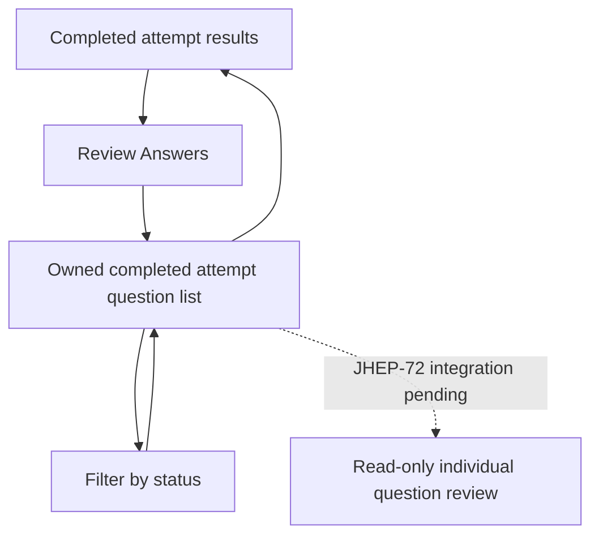

# Completed exam question review (JHEP-37 / JHEP-216)

## Scope and learner journey

A learner with a submitted practice-exam attempt can open **Review Answers** from that attempt's results, browse its original question previews and grading statuses, filter by status, and return to the same results. A submitted attempt awaiting manual grading is still reviewable; its provisional result is not a final pass/fail outcome.



The review list is implemented; individual question selection and detail are not yet enabled. JHEP-72 must supply the working read-only detail route before JHEP-37 AC4 can be closed. The list does not contain a nonfunctional action or link to an unimplemented route. Attempt-history discovery, saved-question journals and new scoring logic are separate scope.

## API contract and ownership

- Browser route: `/exams/{attemptId}/review`.
- Return route: `/exams/{attemptId}/results`.
- API: `GET /api/v1/exams/{attempt_id}/review` with a full `Authorization: Bearer <token>` session.
- Server checks ownership before reading content. Unknown and other users' attempts return the same `404` response, including for staff who do not own the attempt. An unfinished owned attempt returns `409`; missing or invalid authentication returns `401`.
- The successful response is marked `Cache-Control: no-store`; the frontend uses the existing uncached API client.
- `question_version_id` is the originally pinned version UUID, not the parent question ID. Pair it with `attempt_id` for the future JHEP-72 detail contract. This document does not establish an active detail URL.
- Questions are returned in saved `position` order. `question_count` is the attempt's stored count. The preview collapses whitespace and is limited to 160 characters including the ellipsis if truncated.
- An empty question list displays an unavailable/empty state. A nonempty incomplete list, duplicate IDs/positions, invalid status, unfinished status or mismatched attempt ID is rejected by the frontend rather than displayed as valid review data.

Example (illustrative IDs):

```json
{
  "attempt_id": "11111111-1111-4111-8111-111111111111",
  "status": "submitted",
  "question_count": 2,
  "questions": [
    {
      "question_version_id": "22222222-2222-4222-8222-222222222222",
      "position": 1,
      "preview": "What is the purpose of an operating system?",
      "status": "correct"
    },
    {
      "question_version_id": "33333333-3333-4333-8333-333333333333",
      "position": 2,
      "preview": "Explain the difference between a process and a thread.",
      "status": "pending_manual_grading"
    }
  ]
}
```

| API status | Learner label | Meaning |
|---|---|---|
| `correct` | Correct | Persisted correct grading outcome |
| `incorrect` | Incorrect | Persisted incorrect grading outcome, including non-exact multiple-select answers |
| `unanswered` | Unanswered | Persisted unanswered outcome, or no submitted response when no authoritative grade takes precedence |
| `pending_manual_grading` | Pending Grading | Persisted ungraded written response with submitted text |
| `manually_graded` | Manually graded | Human grade has been recorded; a partial score is not relabeled as a binary correctness result |
| `unavailable` | Not graded | No usable grading outcome for a submitted response |

The list contains only the attempt ID/status/count and each question's version ID, position, preview and status. It does not return answer options, submitted responses, correct options, explanations, answer keys or reviewer feedback. The existing results screen retains its separate written-response and grading breakdown behavior.

## Historical integrity

The backend queries `exam_attempt_questions` joined to the pinned `question_versions`, with left joins scoped by both attempt and question-version IDs for grading and submitted responses. Current bank publication state does not determine historical review membership. Retirement or replacement of a version does not change the pinned historical question. Missing grade rows do not remove pinned questions from the list. Drafts are not treated as submitted responses.

The review GET performs no grading, progress updates, answer writes, attempt creation or resubmission. It reflects current persisted human grading outcomes, so a legitimate grade or revision may update review status on a later read. No new database migration or scoring rule is introduced by JHEP-37.

## UX and accessibility

- Status summaries and a labeled native filter; original question numbers are preserved while filtering.
- Text labels alongside decorative status icons, not color-only feedback.
- Responsive wrapping, stacked controls where needed, visible keyboard focus and large return/filter targets.
- Back to Results is available while loading and when the review is empty or unavailable. Retry is offered for recoverable failures, not for denied/unfinished requests.
- Request cancellation and attempt/session-scoped state prevent a stale review response from replacing the current view. A 401 clears the authenticated session through the existing logout flow.

Next.js Cache Components may keep the owner's previous results page in a hidden subtree during client navigation. The privacy regression checks both the preview-only API and the absence of private response text from the review list and visible page; after full reload it checks absence from the whole DOM. This is not a claim that the separate results page or the framework's entire route cache never contains learner responses.

## Verification and release gates

Use the repository's disposable local PostgreSQL database; do not run seed scripts or integration tests against production. From the repository root, with the local environment configured:

```bash
docker compose up -d --wait postgres
```

Backend (`backend/`, project virtual environment):

```bash
.venv/bin/python -m ruff check .
.venv/bin/python -m ruff format --check .
RUN_DB_INTEGRATION=1 .venv/bin/python -m pytest -q
```

Frontend (`frontend/`, dependencies installed):

```bash
npm run lint
npx next typegen
npx tsc --noEmit
npx vitest run
npm run build
```

Browser regression (`frontend/`):

```bash
npx playwright test e2e/completed-exam-review.e2e.ts --project=chromium --workers=1 --reporter=list
npx playwright test --project=chromium --workers=1 --reporter=list
```

The new Playwright suite creates fresh local fixture learners/exams and uses real authenticated API calls for completed attempts. Its loading, network-failure, empty and mismatched-response cases deliberately intercept the review request. Fixtures persist locally. The full browser suite includes the existing global demo seed setup; use only a disposable development/test database.

| Acceptance criterion | Implementation and verification |
|---|---|
| AC1 | Results CTA for submitted attempts, including pending grading; component and browser tests |
| AC2 | Same owned attempt, saved order and previews; PostgreSQL and browser tests |
| AC3 | Accessible grading labels, including pending and manual grades; component, API and browser tests |
| AC4 | Return to results implemented; individual question detail selection still depends on JHEP-72 |
| AC5 | Historical pinning, no write on review/refresh, response/result snapshots; PostgreSQL and browser tests |
| AC6 | Owner-only review and non-disclosing error responses; API and browser tests |
| AC7 | Loading/empty/error states, keyboard navigation, 320/375/768/1024/1440px viewports; component and Chromium tests |

The implementer reported the new five-scenario Chromium suite and checkpoint tests passing locally. Record the full regression outputs separately before merge. Manual screen-reader, actual-device and contrast checks remain release verification tasks; automated viewport and keyboard checks are not a complete accessibility audit. PO acceptance and AC4 integration are still required for the parent story.

### Manual sign-off checklist

- [ ] Navigate with keyboard only: enter review, tab to filter, change status, return to results.
- [ ] Check focus visibility, reading order, headings, labels and error announcements with a screen reader.
- [ ] Verify readable status contrast and text enlargement (200% zoom), without clipped controls or horizontal page scrolling.
- [ ] Inspect touch behavior on a real phone, long question previews and the 40-question list.
- [ ] Verify both immediate and deferred feedback modes and pending written grading; revisit after a legitimate human grade.
- [ ] Verify the JHEP-72 integration when implemented: each question opens its correct attempt-scoped historical detail and returns to the list/results.

See [the API contract](CONTRACT_API_JSON.md#63a-completed-exam-question-list-jhep-37) for the route summary. Implementation sources: `backend/app/services/exam_review_service.py`, `backend/app/schemas/exam_review.py`, `backend/app/api/v1/endpoints/exams.py`, and `frontend/src/features/exam-review/`.
