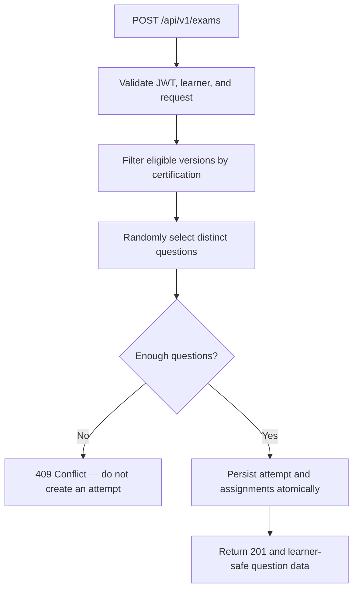

# 🎲 Randomized Practice Exam Generation

> **Feature:** JHEP-29  
> **Stack:** FastAPI · SQLModel · PostgreSQL · Alembic  
> **Scope:** Generate, validate, and persist randomized exam attempts

## 📌 Overview

The exam-generation workflow lets an authenticated learner request a randomized practice exam for a chosen certification. The backend filters the approved question bank, selects distinct questions, saves an attempt with a stable question order, and returns a learner-safe response.

**Out of scope:** answer autosaving, resuming through a GET endpoint, final submission, grading, results, and image uploads.

## 🔄 Request Flow



## 🌐 API Contract

**Endpoint:** `POST /api/v1/exams`  
**Authentication:** `Authorization: Bearer <token>`

### 📥 Example request

```json
{
  "certification_id": "5a61a885-4a36-48c9-ae82-28461b38e31a",
  "question_count": 5
}
```

The learner is identified from the validated JWT, **not** from a `user_id` in the request body. The JWT subject must map to an existing user record.

### 📤 Successful response (`201 Created`)

The response includes the persisted attempt ID, certification ID, status, question count, and questions in their assigned positions. Question and option IDs allow downstream answer saving.

**Never expose:** `is_correct`, `expected_answer`, or internal review/publication metadata.

### 🚦 Error responses

| HTTP status | Meaning |
|---|---|
| ✅ `201` | Attempt created |
| 🔒 `401` | Missing, invalid, or unauthenticated learner |
| 🔍 `404` | Certification not found |
| ⚠️ `409` | Too few eligible questions |
| 🛑 `422` | Invalid request or count |

The API currently has a provisional maximum request size; confirm the final product limit before release.

## 🗂️ Data Model

### `exam_attempts`

Tracks the learner, certification, attempt status, requested question count, current position, and timestamps.

### `exam_attempt_questions`

Tracks the exact selected parent question, **question version**, and position for each attempt.

**Database safeguards:**

- `UNIQUE (attempt_id, question_id)` — no repeated parent question.
- `UNIQUE (attempt_id, position)` — no duplicated display positions.
- Composite reference to `(question_id, question_version_id)` — version must belong to the assigned question.
- Positive positions and valid attempt status/count constraints.

Assignments and the attempt must be committed together; failed creation must not leave partial records.

## ✅ Question Eligibility

A version is eligible when all conditions hold:

```sql
questions.certification_id = :certification_id
AND question_versions.review_status = 'approved'
AND question_versions.publication_status = 'active'
AND question_versions.is_flagged = FALSE
```

The current MVP uses PostgreSQL `ORDER BY RANDOM()` and `LIMIT` for selection. This is suitable for a small bank; reassess performance if the bank becomes substantially larger.

## 🛡️ Security & Integrity

- Verify JWT signatures and expiry; resolve the subject to a real learner.
- Never trust a client-provided learner identity.
- Return answer-option display information, not correctness or short-answer keys.
- Keep attempts and assignments consistent in one transaction.
- Preserve assigned question versions and ordering after generation.
- Treat the published question-version content and answer keys as immutable for existing attempts.

## 🧪 Test Commands

Run from `backend/`:

```bash
ruff check .
ruff format --check .
pytest -q
RUN_DB_INTEGRATION=1 pytest -q
alembic current
alembic check
```

Run integration tests **only against a disposable local test/development database**, not production.

Tests cover filtering, cross-certification isolation, invalid counts, authentication, duplicate prevention, transactional rollback, Unicode/math content, and response safety.

## 🎓 Local Demo & Smoke Test

Use the provided seed data with original sample questions for **PSM I** and **CompTIA Security+**.

### 1. Seed local demo data

```bash
python -m scripts.seed_demo_exams --confirm-local
```

### 2. Start FastAPI

```bash
uvicorn app.main:app --reload
```

Swagger UI: <http://127.0.0.1:8000/docs>

### 3. Test the real endpoint

In another backend terminal:

```bash
python -m scripts.smoke_demo_exams
```

The smoke test generates exam attempts, checks status codes, validates certification isolation and saved database assignments, and verifies that private answer-key data isn't returned. It **leaves demonstration attempts in the local database**.

⚠️ **Local only:** do not use the seeder with production credentials. Never commit `.env` files, secrets, or demo JWTs.

## 🧩 Next Integrations

| Ticket | Responsibility | Backend state |
|---|---|---|
| JHEP-32 | Save responses, navigate, and resume | Backend done (responses, progress, resume) |
| JHEP-34 | Finalize an exam attempt | Backend done (per-question lock, final submit) |
| JHEP-35 | Grade multiple-choice answers | Done (scoring + Pass/Fail + results API) |
| JHEP-36 / JHEP-46 | Present results and feedback | Frontend pending |
| JHEP-57 | Add images to question delivery | Done |

## 🧾 Change Tracking

**JHEP-29:** Exam-generation and persistence foundation complete; later tickets extend the saved attempt rather than reselecting its questions.

**JHEP-35 (+ JHEP-32/34 backends):** automatic MC grading, configurable
thresholds with attempt snapshots, saved learner responses, per-question
locking and final submission, idempotent results, and admin-configured
immediate/deferred feedback modes. Scoring rules per the ticket: single
answers 1/0, strict exact-match multi-select, no partial credit or
negative marking, unanswered = 0; short answers excluded until explicit
grading rules are approved. See docs/grading.md for the full contract.
