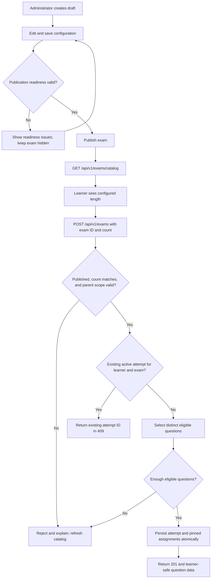

# Randomized Practice Exam Generation and Configuration

<!-- JHEP-207 checkpoint 4D -->

> **Features:** JHEP-29 (generation), JHEP-126 (publication), JHEP-203 (attempt isolation), JHEP-107 (configuration), JHEP-207 (safe deletion and UX stabilization)
> **Stack:** FastAPI · SQLModel · PostgreSQL · Alembic · Next.js
> **Scope:** Administrator-controlled exam configuration, learner discovery and generation, and preservation of existing attempts.

## Overview

An administrator creates and configures a practice exam for a certification and category. Only published, currently startable exams appear in the learner catalog. The learner selects an exam, sees its configured question count, and starts it without changing that count. The backend selects distinct eligible questions, pins their versions and order, and saves the attempt atomically.

Configuration is separate from an attempt. Changing an exam's configured length affects future attempts; it does not resize, regenerate, regrade, or otherwise change existing attempts.

## Administrator workflow

Navigate to **Manage Exams** (`/admin/practice-exams`). Select an exam from the list, then use **Edit exam** when available.

| State | Name, certification, category | Question count | Learner visibility |
|---|---|---|---|
| Draft | Editable | Editable | Hidden |
| Published | Locked | Locked; unpublish first | Visible only while eligible |
| Unpublished | Locked | Editable | Hidden for new starts |

A valid configuration can be saved even when the bank contains too few eligible questions. The readiness panel explains the shortfall and publication remains blocked. The administrator can add eligible questions or reduce the count, then recheck readiness and publish.

The configuration form requires a whole number between 1 and 100. The deployment's `MAX_EXAM_QUESTIONS` setting may impose a lower publication/start limit. The backend permits creating an incomplete draft with a null/omitted count, but a configuration update requires a valid, non-null integer. A draft without a count cannot publish.

On narrow screens, the exam list and selected details are separate views. The form presents field-level errors, retains user input on failed saves, and reports successful saves and current readiness. Cancel does not persist changes. A question-availability hint is based on the last checked category; if the category changes, the server rechecks availability when saving. The desktop layout retains a two-panel workspace.

### Safe deletion

An Administrator may delete only a draft or unpublished configuration with no linked learner attempts. The Manage Exams details view separates Delete exam from editing/publication, requires confirmation, and reports conflicts inline. If learner history exists, leave the exam unpublished instead. No questions, answers, results or catalog parents are removed.

## Request flow



## API contract

All endpoints below use the `/api/v1` prefix. Authenticate with `Authorization: Bearer <token>`. Administrator routes enforce the current administrator role on the backend, not merely UI visibility.

### Administrator practice-exam routes

| Method | Route | Success | Purpose |
|---|---|---|---|
| GET | `/admin/practice-exams` | 200 | List exams and readiness |
| POST | `/admin/practice-exams` | 201 | Create a draft |
| GET | `/admin/practice-exams/{exam_id}` | 200 | Read configuration and fresh readiness |
| PUT | `/admin/practice-exams/{exam_id}` | 200 | Replace editable configuration |
| PATCH | `/admin/practice-exams/{exam_id}/publication` | 200 | Publish or unpublish |
| DELETE | `/admin/practice-exams/{exam_id}` | 204 | Delete an unused draft/unpublished exam |

`PUT` is a full configuration update, not a partial patch. Use the existing exam ID; do not create a new exam to change its count. It does not accept a publication status or learner identity. Preserve the name, certification and category when editing an unpublished exam.

Example configuration request (`PUT`; illustrative IDs and count):

```json
{
  "certification_id": "5a61a885-4a36-48c9-ae82-28461b38e31a",
  "category_id": "42e9c25f-4ada-5147-a894-d7fbcb0df5b7",
  "name": "Computer Science Practice",
  "question_count": 15
}
```

Creation (`POST`) accepts the same fields, with an optional nullable question count. Successful creation, detail, update and publication operations return the administrator exam record, including readiness. For example, a saved unpublished exam with only 12 eligible questions could return:

```json
{
  "id": "11111111-1111-4111-8111-111111111111",
  "certification_id": "5a61a885-4a36-48c9-ae82-28461b38e31a",
  "certification_name": "Computer Science",
  "category_id": "42e9c25f-4ada-5147-a894-d7fbcb0df5b7",
  "category_name": "Fundamentals",
  "name": "Computer Science Practice",
  "question_count": 15,
  "status": "unpublished",
  "readiness": {
    "ready": false,
    "required_question_count": 15,
    "eligible_question_count": 12,
    "issues": [
      {
        "code": "INSUFFICIENT_PUBLISHED_QUESTIONS",
        "message": "Need 15 eligible published questions; only 12 available."
      }
    ]
  }
}
```

List responses have the shape `{ "items": [ ... ], "count": 1 }`. Publication accepts `{ "is_published": true }` or `{ "is_published": false }`.

| HTTP status | Administrator update/publication behavior |
|---|---|
| 401 | Authentication required or invalid |
| 403 | Current role is not administrator |
| 404 | Exam or requested configuration scope not found/invalid (update) |
| 409 | Duplicate name, disallowed edit, or publication not ready |
| 422 | Invalid or missing configuration fields, including invalid counts |

Publication readiness checks certification and category publication, passing threshold, configured count and eligible question supply. A readiness rejection uses `detail.code = "PRACTICE_EXAM_NOT_READY"`, a message and the server's current readiness snapshot. Configuration conflicts use a string detail. Validation errors use FastAPI's validation detail array.

### Administrator deletion

**DELETE** `/api/v1/admin/practice-exams/{exam_id}` — Administrator only; no request body.

Only an unused `draft` or `unpublished` exam may be deleted. The server locks the
exam, checks for any linked learner attempt (including submitted attempts), and
deletes only the configuration. Questions, certifications and categories are not
deleted. The foreign key also prevents removing a configuration referenced by an attempt.

Successful deletion returns `204 No Content` with no JSON response body.
A missing exam returns `404`; authentication and authorization failures return `401`/`403`.
A conflict returns `409` with `detail.code` and `detail.message`:

| Code | Recovery |
|---|---|
| `PRACTICE_EXAM_PUBLISHED` | Unpublish before attempting deletion. |
| `PRACTICE_EXAM_HAS_ATTEMPTS` | Keep the exam unpublished; preserve learner history. |
| `PRACTICE_EXAM_DELETE_CONFLICT` | Refresh the list; other linked records prevent deletion. |

In the Manage Exams UI, deletion is a separate destructive action with explicit
confirmation. The record remains in the list until the server confirms success.
Protected records cannot be force-deleted through this workflow. Unpublishing blocks
new starts without erasing existing attempts or results. Historical attempts with a
null `practice_exam_id` are not inferred to belong to a particular configuration.

### Learner catalog

`GET /api/v1/exams/catalog` returns only currently startable published practice exams. An empty catalog is a successful `200` with `{"exams": []}`. Catalog loading failures must not be treated as empty success.

Example response after publication with enough eligible questions:

```json
{
  "exams": [
    {
      "id": "11111111-1111-4111-8111-111111111111",
      "certification_id": "5a61a885-4a36-48c9-ae82-28461b38e31a",
      "certification_name": "Computer Science",
      "category_id": "42e9c25f-4ada-5147-a894-d7fbcb0df5b7",
      "category_name": "Fundamentals",
      "name": "Computer Science Practice",
      "question_count": 15,
      "available_question_count": 25
    }
  ]
}
```

The learner-facing `/categories` page uses this catalog. Each exam card shows its configured question count and Start exam action. No learner count input is offered. A stale configuration, unavailable exam or insufficient pool requires an explicit reload before another start. A recoverable network error allows a retry. Feedback is displayed beside the affected card. When a start returns an existing attempt ID, the card offers Continue exam and distinguishes the current configured length for new attempts from the original attempt's length.

### Start a practice exam

`POST /api/v1/exams`

```json
{
  "practice_exam_id": "11111111-1111-4111-8111-111111111111",
  "certification_id": "5a61a885-4a36-48c9-ae82-28461b38e31a",
  "category_id": "42e9c25f-4ada-5147-a894-d7fbcb0df5b7",
  "question_count": 15
}
```

The client echoes the catalog count; the server is authoritative. The learner is identified by the validated JWT, not a `user_id` field. Legacy requests without `practice_exam_id` must uniquely match an available published exam by certification, category and count. A certification-only start without a category is rejected by the HTTP publication gate.

A successful `201 Created` includes the persisted `attempt_id`, `certification_id`, `status: "in_progress"`, `question_count`, and questions in their assigned order. The number of assigned questions must equal the configured count.

| HTTP status | Meaning / detail code |
|---|---|
| 201 | Attempt created |
| 401 | Missing or invalid authentication |
| 404 | Certification or category not found |
| 409 | `PRACTICE_EXAM_UNAVAILABLE` — missing, unpublished, ambiguous or unavailable configuration |
| 409 | `PRACTICE_EXAM_COUNT_MISMATCH` — count no longer matches; includes `expected` and `received` |
| 409 | `INSUFFICIENT_QUESTIONS` — eligible bank cannot supply the count; includes `requested` and `available` |
| 409 | `ATTEMPT_IN_PROGRESS` — existing active attempt for learner and exact exam; includes `attempt_id` |
| 409 | `CATEGORY_UNAVAILABLE` or `MISSING_THRESHOLD` |
| 422 | Invalid request or count |

The server checks publication and exact configured count before proceeding to generation. A client with an outdated count must refresh even if the learner has an unfinished attempt for that exam. After refreshing, the existing-attempt conflict can offer continuation without creating a duplicate.

### Resume, answer, submit and results

Existing routes are unchanged:

```http
GET   /api/v1/exams/{attempt_id}
PATCH /api/v1/exams/{attempt_id}/progress
PUT   /api/v1/exams/{attempt_id}/questions/{question_id}/flag
PUT   /api/v1/exams/{attempt_id}/responses/{question_id}
POST  /api/v1/exams/{attempt_id}/responses/{question_id}/submit
POST  /api/v1/exams/{attempt_id}/submit
GET   /api/v1/exams/{attempt_id}/results
GET   /api/v1/exams/{attempt_id}/review
```

Only the attempt owner can retrieve the assigned question versions and saved responses. The original count, order, responses, flags, and grading records survive configuration changes. An unpublished exam blocks new starts but does not invalidate its existing attempts or results. Direct resume of an existing attempt is supported; discovery of all unfinished/unpublished attempts through a history screen is outside this scope. JHEP-37 adds [Review Answers](completed-exam-review.md), a read-only preview list for the same completed attempt. JHEP-72 connects the list to [read-only individual question detail](individual-question-review.md), using the same pinned version, recorded answer and persisted grading outcome.

## Data model and concurrency

- `practice_exams`: configured certification/category, name, count and publication status.
- `exam_attempts`: learner, certification, exact `practice_exam_id` (nullable for historical attempts), original count, position, status, passing-threshold and feedback-mode snapshots, timestamps.
- `exam_attempt_questions`: exact parent question, version and position; per-attempt review flag. Uniqueness constraints prevent duplicate question and position assignments.
- `exam_responses`, `exam_question_grades`, `exam_results`: saved answers and grading records scoped to the attempt.

Existing attempts are not reselected when the catalog changes. Admin configuration updates, publication and deletion use the same PostgreSQL exam row lock; published starts use a shared row lock, held through attempt creation. A unique active-attempt index plus the service's per-learner locking/lookup prevents duplicate active attempts for the same published exam. Historical attempts with a null `practice_exam_id` are not inferred from a category. There is no new migration for JHEP-107.

The eligible-question repository is shared by publication readiness, the learner catalog and randomized selection. It evaluates the matching certification/category, approved active unflagged versions and valid question-type/answer-option configuration. The current PostgreSQL selection uses randomized ordering; reassess performance if the bank becomes substantially larger.

## Security and integrity

- Enforce backend administrator authorization for all configuration, publication and deletion routes.
- Protect both active and completed attempts from deletion of their linked configuration.
- Verify JWT identity and attempt ownership; absent and foreign attempts return the same not-found response.
- Do not accept a learner-selected length or implicitly start a different exam.
- Do not disclose answer keys in newly created or in-progress exam payloads before the applicable feedback policy permits disclosure.
- Preserve pinned versions and their order and keep assignment creation atomic.
- Do not mutate existing attempts, grades or results when saving the exam configuration.

## Testing and acceptance criteria

The checks below are a verification plan and test coverage inventory, not a claim that the full suite has passed. Record actual results before PO handoff.

| AC | Verification |
|---|---|
| AC1 | Admin API update authorization and real admin UI; unauthorized learner/contributor GET and PUT rejected |
| AC2 | Strict schema validation, form-level/inline feedback, cancel and count bounds |
| AC3 | Readiness rejection for insufficient pool and publication/start gating |
| AC4 | Exact catalog count displayed beside Start exam; mobile and desktop browser checks |
| AC5 | Exact submitted start payload, no editable count, stale-count and invalid-configuration recovery |
| AC6 | Isolation tests for increasing/decreasing counts, saved responses/flags/order, completed grades/results and retakes |
| AC7 | Browser create/edit/publish/start/resume/complete/retake workflow and API consistency |

From `backend/` with the virtual environment activated:

```bash
python -m pytest -q
python -m ruff check .
python -m ruff format --check .
RUN_DB_INTEGRATION=1 python -m pytest tests/test_exam_configuration_isolation.py -v
python -m pytest tests/test_admin_practice_exam_deletion.py -v
```

From `frontend/`:

```bash
npm test -- --run
npm run lint
npx tsc --noEmit
npm run build
npx playwright test e2e/exam-publication.e2e.ts e2e/exam-deletion.e2e.ts --project=chromium --workers=1
```

The publication E2E uses the existing local-only `scripts.seed_exam_publication_e2e --confirm-local` fixture. It seeds two eligible questions plus unique accounts and enrollment data, leaving the browser to create and publish the exam. It requires a disposable local PostgreSQL database, backend `.venv`, and configured local MFA. The existing Playwright configuration starts or reuses FastAPI at port 8010 and Next.js at port 3030. It also runs local demo seeders in global setup. Seeded E2E records remain in the local database; never target a remote or production database. Do not commit test credentials, MFA secrets, `.env` files, generated reports or traces.

### Manual responsive and accessibility checks

- At 320, 375, 430 and 768 CSS pixels: no page-level horizontal scrolling; usable exam list, details, edit form, errors, confirmation dialog and learner cards.
- At 1024 and 1440 CSS pixels: readable layout alongside the console navigation; exam length and actions remain clear.
- Keyboard-only: focus moves to invalid fields, returns to the Edit action after cancellation, and confirmation dialogs are operable.
- A valid configuration with an insufficient pool can be saved without publishing; the corrective message is visible.
- Stale learner cards cannot start the wrong count; refresh never automatically starts an exam.
- Use the same learner to complete a one-question attempt after changing the configured length to two, then retake and verify two questions; previous results remain unchanged.

- Cancel a deletion; delete an unused draft; verify linked learner attempts block deletion and that the mobile list and focus recover correctly.

The final approved Innovator desktop/mobile frames and PO acceptance are separate from technical verification. Do not mark design approval or browser tests complete until the evidence is available.

## Change tracking

JHEP-207 adds protected deletion and clears stale learner resume hints when returning to the catalog. A local Chromium run on 27 November 2026 reported all three publication/configuration/deletion scenarios passing. Other browser/device checks and PO acceptance remain separate.

JHEP-29 established exam generation and pinned attempts. JHEP-32/34/35 added saved responses, navigation, submission and grading. JHEP-57 added question media. JHEP-126 established configured publication and learner discovery. JHEP-203 scoped active attempts to the selected published exam. JHEP-107 adds configuration updates and validation, improved learner count/error presentation, and regression coverage across the full journey. See [grading](grading.md) for scoring details and [the API contract](CONTRACT_API_JSON.md) for other endpoints.
