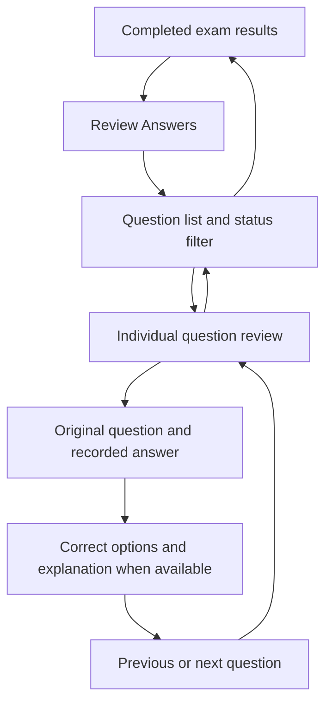

# Individual completed question review (JHEP-72)

JHEP-72 completes the navigation from the [completed exam question list (JHEP-37/JHEP-216)](completed-exam-review.md) to the original, read-only question detail. It helps learners understand mistakes without changing their recorded exam attempt or score.

## Learner journey



- Select any question card in the completed list. The detail identifies its original number and total question count, and displays the full original text, options and images.
- A visible status identifies Correct, Incorrect, Unanswered, Pending Grading, Manually graded or Not graded. Overall status comes from stored grading, not a frontend scoring calculation.
- Options use static text, including **Your answer**, **Correct answer**, **Correct answer · Not selected**, and **Incorrect selection** where applicable. Selection and correctness are separate concepts; an incorrect chosen option never gets a correct-answer indicator. A missing key is explicitly identified, rather than treating a chosen answer as wrong.
- Multiple-select uses the existing strict exact-match scoring rule (JHEP-35): all correct options and no incorrect options are required. The review does not recalculate or award credit.
- Written responses display the recorded text and pending or manually graded status. When available, the recorded score and learner-facing grader feedback appear separately. This screen does not disclose the internal written-answer rubric or invent a model answer.
- Explanations appear only when nonblank. The existing `QuestionMedia` component renders original version-associated images and provides alt-text fallback for unavailable images.
- Back to questions remains available during loading and errors. Previous/next links follow the entire attempt's saved order, not the current filtered subset. At the last question, a link returns to the question list. The list links back to the same results. Filter persistence after navigation/reload is not guaranteed.
- Static answer content contains no answer-selection, text-entry, flagging or submission controls. Navigation links, headings, text status indicators, wrapping, visible focus and touch targets of at least 44 CSS pixels support keyboard and mobile use.

## API contract

Browser route: `/exams/{attemptId}/review/questions/{questionVersionId}`.

```text
GET /api/v1/exams/{attempt_id}/review/questions/{question_version_id}
Authorization: Bearer <full-session-token>
```

Both path identifiers are UUIDs. The second is the original pinned question **version** ID from the preview list, not the parent question ID. The API is GET-only and separate from the preview-only list contract. It requires the authenticated attempt owner and a finally submitted attempt, regardless of immediate/deferred mode. Successful and explicitly handled error responses from this endpoint use `Cache-Control: no-store`; the existing frontend API client also requests `no-store`.

Illustrative response (one incorrectly answered question):

```json
{
  "attempt_id": "11111111-1111-4111-8111-111111111111",
  "attempt_status": "submitted",
  "question_count": 2,
  "question_version_id": "22222222-2222-4222-8222-222222222222",
  "position": 1,
  "question_text": "Which data structure follows FIFO order?",
  "question_type": "multiple_choice",
  "allows_multiple_answers": false,
  "question_status": "incorrect",
  "options": [
    {"id": "33333333-3333-4333-8333-333333333333", "position": 1, "option_text": "Stack"},
    {"id": "44444444-4444-4444-8444-444444444444", "position": 2, "option_text": "Queue"}
  ],
  "images": [],
  "submitted_response": {
    "selected_option_ids": ["33333333-3333-4333-8333-333333333333"],
    "text_response": null,
    "is_submitted": true,
    "answered_at": "2026-11-28T08:00:00Z",
    "question_submitted_at": "2026-11-28T08:00:00Z"
  },
  "correct_option_ids": ["44444444-4444-4444-8444-444444444444"],
  "explanation": "A queue removes items in the order they were added.",
  "grading": {
    "outcome": "incorrect",
    "points_earned": 0,
    "max_points": 1,
    "feedback": null
  }
}
```

| Field | Semantics |
| --- | --- |
| `attempt_status` | Always `submitted` on success. |
| `question_status` | Same six status values as the completed question list. |
| `question_type` | `multiple_choice` or `short_answer`. |
| `options` | Original option IDs, positions and text; empty for written responses. |
| `images` | Original image IDs, positions, alt text, media types and nullable delivery URLs; no raw storage keys. |
| `submitted_response` | Submitted response only; `null` when absent. Written responses have an empty selected-option array. |
| `correct_option_ids` | Original correct option IDs; `null` if no usable key exists or the question is written. |
| `explanation` | Original nonblank explanation, otherwise `null`. |
| `grading` | Stored outcome, points, nullable maximum and nullable feedback; `null` if no grade exists. Feedback is exposed only for a manually graded outcome. |

| HTTP status | Meaning |
| --- | --- |
| 200 | Owned, submitted, assigned historical question. |
| 401 | Missing/invalid authentication. |
| 404 | Unknown or foreign attempt, or version not assigned to that attempt; identical non-disclosing body. Staff do not bypass ownership. |
| 409 | Owned attempt not completed, or inconsistent stored detail (`QUESTION_REVIEW_UNAVAILABLE`). |
| 422 | Malformed UUID path parameter. |
| 405 | Unsupported mutation method on this route. |

## Historical integrity and privacy

The service authorizes the attempt before loading any question content or answer keys, and checks final submission before joining the attempt's original pinned question version. Grades and submitted responses are joined on both attempt and version IDs; drafts are excluded. Options and images are ordered by their original position. Replacement/retirement of a bank version does not reassign historical attempts. Existing pinned versions must remain immutable through the normal editing workflow; this is not a new independent snapshot of every historical field or a defense against arbitrary direct database edits.

The service uses read-only queries and does not grade, submit, alter responses, update navigation, or commit. It does not disclose reviewer identity, internal notes, or written grading keys. Legitimate subsequent human grading may update a later review's stored grading status/feedback. The frontend validates IDs, status, option/selection consistency and navigation membership, suppresses stale requests on session/route changes, cancels superseded requests, clears expired sessions, and offers retry for recoverable failures. It performs a detail GET followed by the preview-list GET to derive neighbors; both must succeed consistently before content renders. The existing in-exam feedback policy and preview-only list are unchanged.

## Testing

Use only a disposable local PostgreSQL database. Fixtures create fresh learners/exams and leave local records behind. The historical fixture's replacement action is restricted to its own completed test attempt. No migration, new runtime dependency or production seed is required.

Backend from `backend/`:

```bash
.venv/bin/python -m ruff check .
.venv/bin/python -m ruff format --check .
RUN_DB_INTEGRATION=1 .venv/bin/python -m pytest -q
```

Frontend from `frontend/`:

```bash
npm run lint
npx next typegen
npx tsc --noEmit
npx vitest run
npm run build
npx playwright test e2e/completed-exam-review.e2e.ts e2e/individual-question-review.e2e.ts --project=chromium --workers=1 --reporter=list
npx playwright test --project=chromium --workers=1 --reporter=list
```

| Acceptance criterion | Implementation and verification |
| --- | --- |
| AC1 — Open review | Clickable list entries, original numbering and full content; route, component and browser navigation tests. |
| AC2 — Submitted and correct answers | Static labels, saved exact-match outcome, unanswered and missing-key handling; schema, service, component, DB and browser tests. |
| AC3 — Explanation | Original optional explanation, reused media component, Unicode/plain-text math, long text and image fallback tests. Dedicated LaTeX typesetting is not added. |
| AC4 — Read-only history | Owner/completion/assignment checks, GET-only detail, unchanged response/result snapshots, rejected edits and historical replacement tests in both feedback modes. |
| AC5 — Reuse and accessibility | Reuses existing image renderer, shared review status labels, API DTOs/client and auth conventions. Uses static option presentation instead of disabled live-exam form controls; keyboard, mobile touch and 320/375/768/1024/1440px viewport checks. |

### Observed targeted verification (2026-11-28)

- Backend checkpoint tests reported passing by the implementer after correcting the HTTP route registration test.
- Existing JHEP-37 Chromium suite: 5 passed in 24.8s.
- New JHEP-72 Chromium suite: 6 passed in 35.4s (immediate/deferred journeys, security, historical replacement, error recovery/image fallback and touch-enabled mobile).
- These are two separate targeted browser runs, not evidence of a combined or complete repository browser run. Record final lint, type checking, backend/frontend full regression, build and CI outputs before merge.

### Remaining release sign-off

- [ ] Run the combined 11-scenario browser regression and the entire application suite, and confirm CI on the integrated target branch.
- [ ] Review actual phone portrait/landscape layout, scrolling and touch controls.
- [ ] Verify screen-reader reading order, visible keyboard focus, contrast and 200% zoom.
- [ ] Confirm the Figma reference and product-owner expectations, including filter return behavior and supported equation notation. Unicode/plain-text equations are preserved; dedicated LaTeX rendering has not been implemented.
- [ ] Verify actual R2/CDN image delivery in a suitable test environment; the browser suite controls image delivery and failure.
- [ ] Confirm JHEP-37 is merged and the JHEP-72 PR contains only intended changes after synchronization.

## Implementation references

- `backend/app/api/v1/endpoints/exam_question_review.py`
- `backend/app/services/exam_question_review_service.py`
- `backend/app/schemas/exam_question_review.py`
- `backend/tests/test_exam_question_review_*.py`
- `frontend/src/features/exam-review/`
- `frontend/src/lib/exam-question-review.ts`
- `frontend/src/app/exams/[attemptId]/review/questions/[questionVersionId]/page.tsx`
- `backend/scripts/seed_question_review_e2e.py`
- `frontend/e2e/individual-question-review.e2e.ts`
